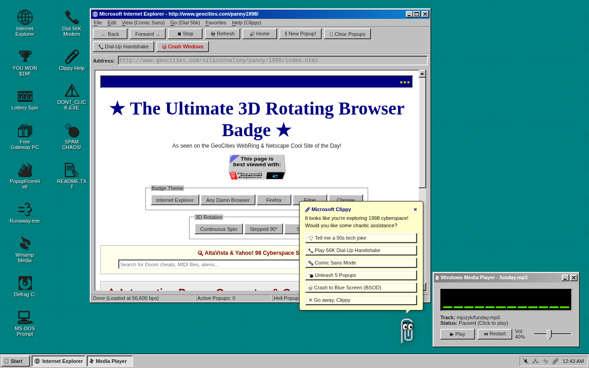
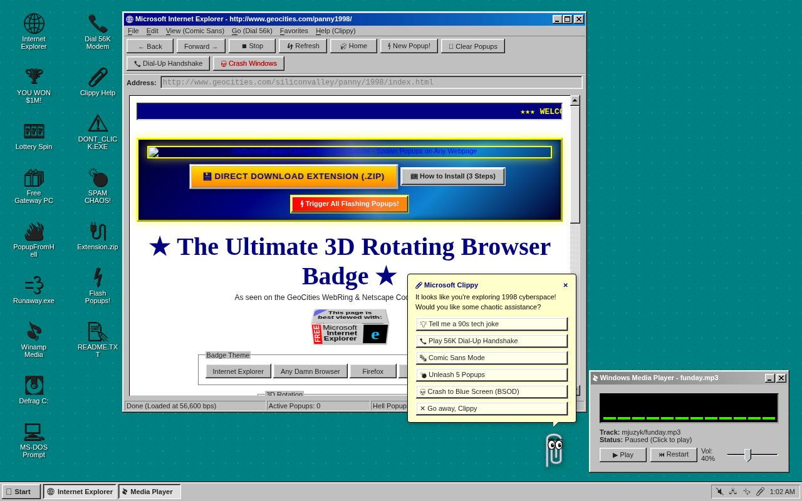
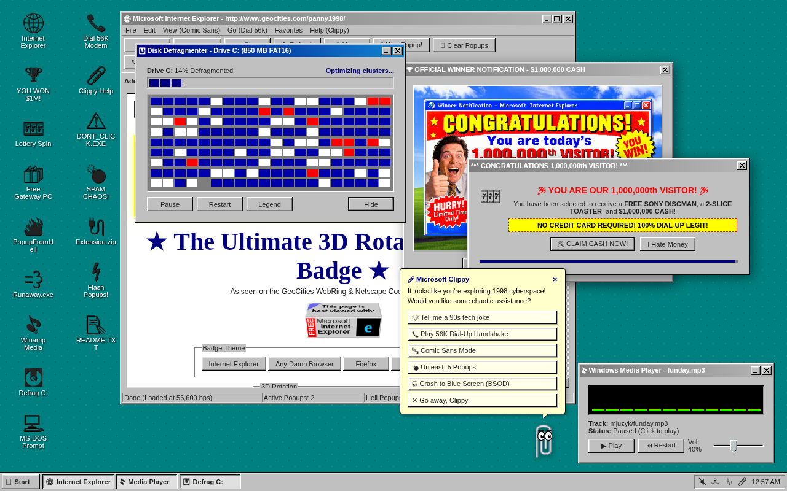
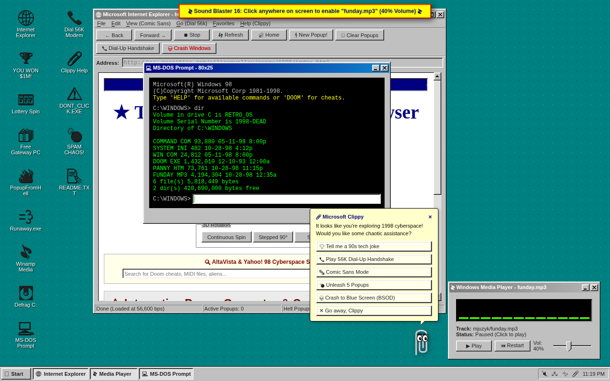
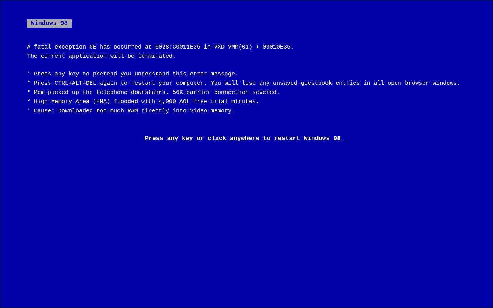

# 🪟 OldSchoolPopups: Cyberspace 1998 & The Popup Simulator

<div align="center">

[](https://retropop-98.pages.dev)
[](https://retropop-98.pages.dev)
[](https://retropop-98.pages.dev)
[](https://retropop-98.pages.dev)
[](LICENSE)

### 🌐 **LIVE WEB EXPERIENCE**: [https://retropop-98.pages.dev](https://retropop-98.pages.dev)

*Put on your headphones, tell your mom not to pick up the kitchen telephone, and dive back into 1998.*

</div>

---

## 📸 System Screenshots

### 🖥️ Windows 98 Cyberspace Desktop & Clippy Assistant


### 🔌 Chrome Extension Banner & Internet Explorer 4.0


### 💥 Ad Avalanche, Disk Defragmenter & $1,000,000 Winner Popup


### 💻 Authentic MS-DOS Prompt (`command.com`)


### 💀 Full-Screen Blue Screen of Death (BSOD)


---

## ⚡ Features & Cyber Nostalgia

### 🌐 Microsoft Internet Explorer 4.0
- **3D Rotating "Best Viewed With..." Badge**: Authentic CSS 3D transformed rotating polygon badge with faces for Internet Explorer, Firefox, Netscape ("Use Any Damn Browser"), Safari, Edge, and Chrome.
- **AltaVista & Yahoo! 98 Cyberspace Search**: Query 1998 cyberspace and uncover GeoCities homesteads under construction since 1996.
- **GeoCities WebRing Navigator**: Hop between neighboring cyber shrines (Aliens in Area 51, Dragon Ball Z MIDI archives, Sailor Moon fan clubs).
- **Under Construction Warnings**: Blinking red warning stripes and animated pixel construction signs.
- **Hit Counter & Live Guestbook**: Interactive visitor counter (`0074291`) with "Ka-Ching!" sounds and a live scrolling signature marquee.

### 💣 The Chaos Popup Engine & Tomas Petricek's Hydra
- **🔥 Tomas Petricek's "Popup from Hell"**: Based on Tomas Petricek's 2021 programming talk. A notorious JavaScript Hydra: **closing one popup immediately spawns two!** Featuring the infamous `stars.bmp` background and runaway marquee.
- **⚡ Flashing Neon Popups Collection**:
  - **🎰 777 Casino Jackpot**: Flashing rainbow/gold border, coin chimes, and double-or-nothing stakes.
  - **🚨 Chernobyl / Nuclear Core Meltdown**: Emergency siren strobe, cooling rod overload, and CRT monitor eject buttons.
  - **💖 Hot Single Routers in Your Subnet**: Pink/cyan neon border connecting you with Cisco 2500 routers near `192.168.1.1` with 0.01ms latency.
  - **👻 Cursed 1998 Chain Letter**: Forward to 10 ICQ contacts or Billy's vanished mouse trackball curse will befall you.
  - **💿 5,000 Hours of AOL Free Trial CDs**: America Online shipping a pallet of 250 plastic CD cases to use as Frisbees.
  - **👶 1996 3D Dancing Baby (Oogachaka)**: Uncanny valley 3D Studio MAX groove permanently hypnotizing your screen.
  - **⚠️ SubSeven / NetBus Trojan**: Remote hacker playing with your CD-ROM tray; retaliate with a 65,535-byte Ping of Death.
  - **👁️ Matrix Anomaly**: Green phosphor stream with red pill / blue pill choice.
  - **🎁 Visitor #999,999,999**: Claim your neon green 256MB MP3 player with USB 1.1 sync cable.
- **🏆 Official $1,000,000 Winner Poster**: High-resolution retro prize notification loaded with shiny trophies and claim buttons.
- **🎁 Free Gateway 2000 Computer Ad**: Complete with a 19-inch CRT monitor and 48x CD-ROM drive.
- **💨 Runaway Evasive Decline Button**: An offer you literally cannot decline because the "Decline" button dodges your cursor whenever you try to click it.
- **🎵 Limewire MP3 Alert**: Downloaded `Britney_Spears_Baby_One_More_Time_REAL_SONG_NO_VIRUS.exe (18.4 KB)`. Why is an MP3 an executable file with a skull icon?
- **⏳ Y2K Bug Apocalypse Warning**: Protect your microwave and wristwatch from the Year 2000 millennium bug with canned peaches.

---

## 🔌 OldSchoolPopups Chrome Extension (Popups on ANY Webpage!)

Want retro 1998 chaos everywhere on the web? Download the companion **OldSchoolPopups Chrome Extension** to inject authentic Windows 98 popups, flashing casino jackpots, and evasive buttons on **Google, Wikipedia, YouTube, Reddit, or any site**!


### 📦 Download & Install:
1. Download [**`oldschoolpopups-extension.zip`**](https://retropop-98.pages.dev/oldschoolpopups-extension.zip).
2. Unzip the file into a folder on your computer.
3. In Chrome / Brave / Edge, open `chrome://extensions`.
4. Turn on **Developer mode** (top-right toggle switch).
5. Click **"Load unpacked"** and select the unzipped folder.
6. Browse any website and enjoy harmless 1998 cyberspace nostalgia!
   - Built with **Manifest V3** and strict **Shadow DOM isolation** (never breaks website layouts).
   - Zero analytics, zero data collection, 100% offline & safe.
- **💿 AOL 5,000,000 Hours Delivery**: A delivery truck has dumped 4,200 installation CD-ROMs onto your driveway.
- **🦍 BonziBuddy 4.0**: Your friendly purple gorilla assistant cracking 56k modem jokes.

### 📎 Microsoft Clippy Assistant
- Crisp, animated SVG paperclip assistant complete with expressive cartoon googly eyes and eyebrows.
- Interactive speech bubble menu:
  - 💡 *Tell 90s Tech Joke*
  - 📞 *Play Dial-Up Modem Handshake*
  - 🔤 *Comic Sans MS Mode* (instantly transforms all site typography)
  - 💣 *Unleash 5 Popups*
  - 💀 *Crash to BSOD*
- Periodic hilarious 90s tips and poking reaction animations.

### 💽 Disk Defragmenter (`defrag.exe`)
- Interactive Windows 98 disk defragmentation simulation on `Drive C: (850 MB FAT16)`.
- Real-time animated cluster map grid featuring allocated clusters (blue), free space (white), bad sectors (red), and moving/reading clusters (yellow & green).
- Progress bar advancing with pause, resume, and legend controls.

### 💻 MS-DOS Prompt (`command.com`)
- Fully functional retro command terminal window supporting:
  - `DIR`: List directory files (`DOOM.EXE`, `PANNY.HTM`, `FUNDAY.MP3`, `COMMAND.COM`).
  - `VER`: Displays `Microsoft(R) Windows 98 [Version 4.10.1998]`.
  - `DOOM` / `IDDQD`: Activates God Mode.
  - `MATRIX`: Toggles raining green 90s digital rain across the entire desktop.
  - `BSOD`: Crashes the operating system.
  - `CLIPPY`: Summons Clippy.
  - `FORMAT C:`: Fake format scare with Windows 98 safety save.
  - `HELP`: Lists available commands.

### 📞 56K Web Audio Dial-Up Synthesizer
- Built **100% in vanilla JavaScript with the browser Web Audio API** (zero external sound files required):
  1. Dual-tone Dial Tone (350Hz + 440Hz).
  2. DTMF touch-tone dialing sequence (`1-800-438-265`).
  3. Ringback cadence.
  4. 2100Hz carrier answer tone.
  5. Scrambled baud frequency chirps & FM screech negotiation.
  6. Triumphant "CONNECT 56000 bps V.90" chime!

### 🎵 Winamp / Windows Media Player
- Authentic retro media player docked in the bottom-right playing `mjuzyk/funday.mp3` at safe 40% volume.
- Real-time animated 12-band visualizer graphic equalizer.
- Play, pause, restart, and custom volume slider controls.

### ✨ 90s Star / Sparkle Mouse Trail
- Twinkling colored neon stars (`✦`, `★`, `✧`) drift behind your mouse cursor across the desktop.
- Toggle on/off via the system tray icon (`✨`) or Start Menu.

### 🎮 Konami Code Easter Egg
- Type `↑ ↑ ↓ ↓ ← → ← → B A` anywhere on keyboard to trigger the victory fanfare, 30 extra lives, matrix digital rain, and an instant popup celebration!

---

## 🏃 Start Menu "Run..." Commands

Press `Start -> Run...` or open MS-DOS prompt to execute any of these secret shortcuts:

| Command | Action |
|---|---|
| `clippy` | Summons Microsoft Clippy assistant |
| `bsod` | Triggers the fatal Blue Screen of Death |
| `defrag` | Opens Disk Defragmenter for Drive C: |
| `dialup` / `modem` | Plays synthesized 56K modem handshake |
| `matrix` | Toggles digital green rain on desktop background |
| `cmd` / `dos` | Opens 80x25 MS-DOS Prompt |
| `winamp` | Focuses the Media Player |
| `hell` | Spawns Tomas Petricek's Hydra Popup |
| `winner` | Spawns the $1,000,000 Grand Prize Winner poster |
| `comic` | Toggles all typography into Comic Sans MS |
| `stars` | Toggles the retro star mouse trail |

---

## 🛠️ Tech Stack & Directory Structure

```
funnypannypagecss/
├── 98.css                                # Authentic Windows 98 CSS framework
├── AGENTS.md                             # Antigravity project instructions & verification rules
├── bestviewedwith.html                   # 3D rotating browser badge component reference
├── windows98buttons.html                 # Retro beveled button styles reference
├── index.html                            # Master OldSchoolPopups Windows 98 desktop & popup simulator
├── oldschoolpopups-extension.zip         # Chrome Extension packaged bundle
├── mjuzyk/
│   └── funday.mp3                        # Background retro track
├── images/
│   ├── extension-banner.svg              # Retro 90s cyber download banner
│   ├── ad1.png                           # Gateway 2000 Computer Ad
│   ├── ad2.avif                          # Special offer banner
│   ├── lotofads.png                      # Ad avalanche banner
│   └── Retro Internet Explorer Winner Popup.png # 1536x1024 Winner Popup
├── screenshots/
│   ├── desktop-clean.png                 # Clean desktop screenshot
│   ├── desktop-chaos.png                 # Popup chaos screenshot
│   ├── extension-banner-view.png         # Extension download banner screenshot
│   ├── msdos.png                         # MS-DOS prompt screenshot
│   └── bsod.png                          # Blue Screen of Death screenshot
└── extension/                            # Manifest V3 Chrome Extension source
    ├── manifest.json                     # Chrome Extension manifest
    ├── background/                       # Service worker
    ├── content/                          # Popup injector with Shadow DOM
    └── popup/                            # Extension toolbar popup interface
```

---

## 🚀 Local Development

1. **Clone the repository**:
   ```bash
   git clone https://github.com/administrakt0r/OldSchoolPopups.git
   cd OldSchoolPopups
   ```

2. **Serve with any local web server**:
   ```bash
   python3 -m http.server 8000
   ```

3. **Open in browser**:
   Navigate to `http://localhost:8000/index.html`.

4. **URL Parameters for Testing / Demos**:
   - `?clean=1`: Bypasses login dialog for an unobstructed view.
   - `?demo=1`: Auto-launches Disk Defragmenter and banner popups.
   - `?bsod=1`: Directly launches the Blue Screen of Death.
   - `?dos=1`: Directly launches MS-DOS Prompt with `DIR` listing.

---

## ☁️ Cloudflare Pages Deployment

This project is deployed to Cloudflare Pages using Cloudflare Wrangler CLI:

```bash
wrangler pages deploy . --project-name=retropop-98 --branch=main
```

Production URL: **[https://retropop-98.pages.dev](https://retropop-98.pages.dev)**

---

## 📜 Credits & Historical Lore

- **Tomas Petricek**: Creator of the original *Popup from Hell* retrospective talk (2021) dissecting the legendary JavaScript Hydra popups of the late 1990s web.
- **jdan / 98.css**: Faithfully designed Windows 98 CSS components.
- **GeoCities, Netscape & Sound Blaster 16**: The eternal heroes of dial-up cyberspace.

---

<div align="center">
  <sub>Best viewed in Microsoft Internet Explorer 4.0 at 800x600 resolution in 16-bit High Color.</sub>
</div>
